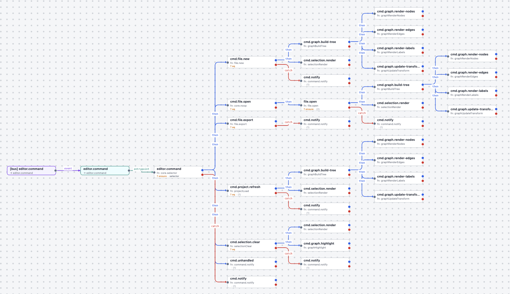

# Slapflow

Когда один и тот же сценарий запускается из формы, HTTP API, фоновой задачи или WebSocket-сообщения, его логика быстро расползается по обработчикам и сервисам. Slapflow помогает собрать её в одном явном месте — в цепочке обычных TypeScript-функций.

[](https://bundlephobia.com/package/slapflow)
[](https://socket.dev/npm/package/slapflow/overview/1.0.2)

Slapflow берёт на себя порядок выполнения, конкурентность, отмену и диагностику. Состояние предметной области и побочные эффекты по-прежнему остаются в вашем приложении.



## Когда он пригодится

- **Когда важен сам сценарий, а не инфраструктура вокруг него.** Цепочка показывает бизнес-поток целиком, вместо того чтобы прятать его среди UI-обработчиков и транспортного кода.
- **Когда сценарий хочется проверить отдельно от приложения.** Передайте контекст и событие снаружи: действия и условия остаются обычными TypeScript-функциями.
- **Когда асинхронность должна быть предсказуемой.** Для источника событий выберите `parallel`, `latest`, `queue`, `drop` или `workers`; при необходимости действие получит `AbortSignal` для отмены.
- **Когда один поток нужен в нескольких местах.** Одну и ту же цепочку можно запускать из типизированной шины, DOM-события, API-колбэка, таймера, воркера или WebSocket-сообщения.

### Когда использовать Slapflow

Slapflow оркестрирует поток управления, который начинается и завершается внутри одного процесса. Используйте его, когда сценарий состоит из нескольких шагов, ветвлений и обработчиков ошибок и хочется держать их в одном месте, а не размазывать по обработчикам и колбэкам.

**Чем он не является:** не веб-фреймворк (нет роутинга и middleware-стека — сочетайте с Express, Hono или роутами Next.js) и не очередь задач (нет встроенной персистентности и распределённых воркеров). Также это не долгоживущий workflow-движок: цепочка выполняется внутри живого процесса и завершается вместе с ним — `core.loop` может крутиться бесконечно, пока процесс работает, но, в отличие от Temporal, нет состояния, которое переживало бы падение или рестарт, если ваше приложение само об этом не позаботилось. Ближе всего — лёгкая внутрипроцессная state machine: решения, порядок, конкурентность и отмена живут в цепочке, а предметное состояние и побочные эффекты остаются в вашем приложении.

## Установка

```bash
npm install slapflow
```

## Быстрый старт

Пример обрабатывает отправку заказа из типизированной шины событий. Режим `latest` отменит предыдущую отправку того же заказа, когда придёт новое событие.

```ts
import { createFlow, createPubSub } from 'slapflow'

type Context = {
  orders: Map<string, { id: string; status: 'draft' | 'submitted' }>
}

type Events = {
  'order.submit': { orderId: string }
}

const bus = createPubSub<Events>()
const context: Context = {
  orders: new Map([['order-1', { id: 'order-1', status: 'draft' }]]),
}

const flow = createFlow<Context, unknown, Events>(
  {
    events: {
      '[bus] order.submit': {
        entrypoint: 'order.submit',
        options: {
          concurrency: {
            mode: 'latest',
            key: ({ orderId }) => orderId,
          },
        },
      },
    },
    actions: {
      'order.submit': ({ context, input }) => {
        const order = context.orders.get(input.orderId as string)

        if (order) {
          order.status = 'submitted'
        }
      },
    },
    config: {
      entrypoints: { 'order.submit': 'order.submit' },
      strategies: { 'order.submit': { fn: 'order.submit' } },
    },
  },
  { bus, context }
)

flow.start()
bus.emit('order.submit', { orderId: 'order-1' }, { origin: 'api' })
```

## Точки входа в логику приложения

**Entrypoint — реальный именованный вход в логическую часть приложения, а не просто alias на стратегию.** Он обозначает сценарий, который запускает вызывающая сторона: например, отправку заказа или запуск прохода симуляции. Стратегия описывает шаг выполнения и его продолжение.

`entrypoints: { 'order.submit': 'order.validate' }` объявляет вход приложения `order.submit` и выбирает `order.validate` его первым шагом реализации. Имя входа — часть контракта вызова приложения; целевая стратегия может меняться при развитии реализации. Совпадение имени входа и стратегии не делает вход лишним.

События запускают выполнение. Допустимы все три маршрута:

- `entry → strategy`: вызывающая сторона запускает именованный вход приложения.
- `event → strategy`: привязка запускает стратегию напрямую.
- `event → entry → strategy`: привязка запускает именованный вход приложения.

**Правило для моделей:** сохраняйте объявленные entrypoints и обращения к ним. Запрещено удалять входы, встраивать их цели в привязки или заменять обращения прямыми вызовами стратегий только ради сокращения конфига или упрощения графа. Прямой запуск стратегий поддерживается наряду с именованными входами. Изменение или удаление входа приложения требует явного запроса, который охватывает изменение этого контракта.

## Операции над объектами внутри actions

Каждое действие получает общий набор `tools` рядом с `context`, `props`,
`input`, `signal` и `runtime`. Функции доступны без импорта библиотеки objwalk:

```ts
const clearPreview = ({ context: { cache }, tools: { flush } }) => {
  flush(cache, ['preview', 'stale'])
}
```

Readonly-набор содержит `pick`, `set`, `flush`, `extract`, `each`, `map`, `merge`,
`clone`, `equally`, `diff`, `parse`, `stringify`. Это исходные функции objwalk.
Для одного уровня обхода или преобразования передайте `{ shallow: true }`.
`map` возвращает преобразованные значения под исходными ключами; `each` посещает
значения и останавливается, если callback возвращает `false`.

`runtime.set(path, value)` пишет в context текущего run с учётом его жизненного
цикла. `tools.set(target, path, value)` меняет переданный объект напрямую и
не добавляет проверки runtime. Заморожен сам набор функций, а не входные данные.

**Миграция ручных вызовов actions:** поле `ActionArgs.tools` обязательно.
При самостоятельной сборке аргументов импортируйте общий `tools` из `slapflow`
и добавьте его в объект аргументов. При вызове через runner набор передаётся
автоматически. Тип `Tools` также экспортируется.

## Загрузка данных с отменой и ретраями

`core.fetch` использует `AbortSignal` запуска, повторяет временные ошибки и передаёт ответ следующей стратегии, не привязывая сценарий к конкретному HTTP-клиенту.

```ts
const config = {
  strategies: {
    'catalog.load': {
      fn: 'core.fetch',
      props: {
        url: '/api/catalog',
        response: 'json',
        dataPath: 'catalogResponse',
        retry: { maxAttempts: 2, initialDelay: 250, maxDelay: 1_000 },
      },
      then: ['catalog.apply'],
    },
    'catalog.apply': { fn: 'catalog.apply' },
  },
}

const applyCatalog = ({ runtime }) => {
  const { body } = runtime.data.get('catalogResponse')

  // Обновите состояние приложения данными из body.
}
```

## Ветвление со сложными условиями

Каждая цель в `then` и `catch` может иметь собственное условие. Встроенные условия комбинируются через `and`, `or` и `not`, поэтому ветвление остаётся в графе:

```ts
const config = {
  strategies: {
    'catalog.load': {
      fn: 'core.fetch',
      props: {
        url: '/api/catalog',
        response: 'json',
        dataPath: 'catalogResponse',
      },
      then: [
        {
          strategy: 'catalog.apply',
          when: [
            'and',
            ['typeIs', '$data.catalogResponse.body', 'record'],
            ['typeIs', '$data.catalogResponse.body.items', 'array'],
            ['not', ['empty', '$data.catalogResponse.body.items']],
          ],
        },
        {
          strategy: 'catalog.showEmpty',
          when: ['or', ['missing', '$data.catalogResponse.body.items'], ['empty', '$data.catalogResponse.body.items']],
        },
      ],
      catch: [
        {
          strategy: 'catalog.queueRetry',
          when: ['and', ['falsy', '$context.network.online'], ['includes', ['startup', 'refresh'], '$input.source']],
        },
        {
          strategy: 'catalog.showError',
          when: ['or', ['truthy', '$context.network.online'], ['eq', '$input.source', 'manual']],
        },
      ],
    },
    'catalog.apply': { fn: 'catalog.apply' },
    'catalog.showEmpty': { fn: 'catalog.showEmpty' },
    'catalog.queueRetry': { fn: 'catalog.queueRetry' },
    'catalog.showError': { fn: 'catalog.showError' },
  },
}
```

## Типы полей и проверка наличия

Допустимые типы полей можно объявить один раз для `when` и именованных guards:

```json
{
  "types": {
    "colonyId": "string",
    "requestId": "string",
    "instanceId": "string",
    "targetInstanceId": "string"
  },
  "guards": {
    "claim-request-valid": ["contains", "$input", ["colonyId", "requestId", "instanceId", "targetInstanceId"]]
  },
  "strategies": {
    "claim.process": {
      "fn": "claim.process",
      "when": ["guard", "claim-request-valid"]
    }
  }
}
```

`contains` проверяет все перечисленные собственные поля объекта: каждое должно соответствовать объявленному типу и иметь значение, отличное от `null` и `undefined`. `false`, `0` и пустая строка считаются существующими. Без `types` оператор проверяет только наличие значений.

Для вложенного объекта достаточно изменить первый операнд: `["contains", "$input.payload", ["colonyId", "requestId"]]`. Прямые ссылки вроде `$context.session.owner.userId` тоже проверяются по имени последнего поля, независимо от глубины.

Типы проверяются только при чтении полей условием. Остальные поля, props и результаты действий не обходятся. Ошибка типа даёт `TYPE_MISMATCH`; непройденная проверка наличия даёт обычный `false`. Nullable-поле объявляется как `["string", null]`, допустимое отсутствие — с вариантом `"undefined"`. Подробнее — в [спецификации типов полей](SPEC-RU.md#типы-полей-в-условиях).

## Отдельное вычисление условий и выражений

`evaluateCondition` и `evaluateExpression` работают без создания flow или runner и используют тот же вычислитель:

```ts
import { evaluateCondition, evaluateExpression } from 'slapflow'

const condition = evaluateCondition(['contains', '$input', ['colonyId', 'requestId']], {
  context: {},
  input: { colonyId: 'c-1', requestId: 'r-1' },
  types: { colonyId: 'string', requestId: 'string' },
})
const duration = evaluateExpression(['multiply', '$input.seconds', 1000], { context: {}, input: { seconds: 2 } })
```

Хелперы синхронные. `evaluateCondition` возвращает `{ ok: true, matched }` или `{ ok: false, error }`, а `evaluateExpression` — `{ ok: true, value }` или `{ ok: false, error }`. Ошибка отличается от обычного несовпадения условия. Ссылку `['guard', name]` для отдельного вычисления нужно заранее заменить самим выражением из `config.guards`.

## Фан-аут через keyed-пул

Привязка `workers` прогоняет задачи через общий пул: одновременно не более `workers` запусков, задачи с одним ключом линии идут строго по FIFO и никогда параллельно, разные ключи — параллельно. Действие раскладывает работу по именованному пулу через `runtime.enqueue`:

```ts
const flow = createFlow<Context, Patch, Events>(
  {
    config,
    actions: {
      'world.tick': async ({ input, runtime }) => {
        for (const colonyId of Object.keys(context.colonies)) {
          await runtime.enqueue('colony.tick', { tick: input.tick, colonyId }, { pool: 'colony', key: colonyId })
        }
      },
    },
    events: {
      // диспетчер работает вне пула, который питает
      '[bus] game.tick': { entrypoint: 'world.tick', options: { concurrency: { mode: 'parallel' } } },
      '[bus] colony.observed': {
        entrypoint: 'colony.observed',
        options: { concurrency: { mode: 'workers', pool: 'colony', key: '$input.colonyId' } },
      },
    },
  },
  {
    context: () => store.getState(),
    bus,
    pools: { colony: { workers: 4, maxQueueSize: 2_000, overflow: 'wait' } },
  }
)
```

`overflow: 'wait'` применяет backpressure вместо потери принятой работы. Задача не может ставить работу в собственный пул (`ENQUEUE_SELF_POOL`), поэтому диспетчер фан-аута работает вне `colony`. `flow.poolStats('colony')` отдаёт `active`/`queued`/`oldestQueuedMs`, а `flow.drain({ timeoutMs })` ждёт опустошения пулов и линий привязок при остановке.

Пул живёт внутри процесса и в памяти: он ограничивает конкурентность и сохраняет порядок внутри ключа, но не является дисковым хранилищем.

## Что даёт Slapflow

- Декларативные стратегии, условия, ветки обработки ошибок и точки входа.
- Большой набор [встроенных условий](SPEC-RU.md#встроенные-условия) для сравнений, проверки типов, коллекций и составной логики.
- Общие объявления типов для полей, используемых условиями, и `contains` для проверки наличия нескольких полей объекта.
- Самостоятельное вычисление условий и выражений через `evaluateCondition` и `evaluateExpression`.
- Типизированные PubSub-привязки и делегированные DOM-привязки.
- Режимы `parallel`, `latest`, `queue` и `drop` с отдельными линиями для разных сущностей, а также keyed-пул `workers` с именованными пулами, backpressure и фан-аутом через `runtime.enqueue`.
- Нативный WebSocket-клиент, проксирующий события сокета в шину.
- `core.fetch` с разбором ответа, отменой и retry backoff.
- `core.invoke` — прогон ветки `then` по элементам массива или объекта; каждый элемент доступен в ветке как `$input`.
- Нормализованный результат, трассировку выполнения, проверку конфигурации и диагностические события вроде `slapflow.run.started` и `slapflow.run.failed`.
- Runtime-переменные для значений конфигурации, шаблонов и выражений.

## Дальше

- Посмотрите на [slapflow-studio](https://github.com/khalilov/slapflow-studio) — работающее приложение, целиком построенное на Slapflow.
- Полный контракт API, встроенные действия и условия, выражения, валидация, ограничения безопасности, транспорт и жизненный цикл описаны в [спецификации](SPEC-RU.md).
- English documentation: [README.md](README.md) and [SPEC.md](SPEC.md).

## Разработка

```bash
npm test
npm run build
npm run pack:check
```

## Навык для агентов

Пакет содержит `SKILL.md` в `skills/slapflow/`. Укажите агенту на **папку**, а не на файл `SKILL.md`.

| Инструмент  | Расположение                                                    | Установка |
| ----------- | --------------------------------------------------------------- | --------- |
| opencode    | `opencode.json` → `skills.paths`                                | конфиг    |
| Claude Code | `~/.claude/skills/` (личный) или `.claude/skills/` (проект)     | symlink   |
| Codex       | `~/.agents/skills/` (пользователь) или `.agents/skills/` (репо) | symlink   |

opencode — добавьте путь к пакету в `opencode.json`:

```json
{
  "$schema": "https://opencode.ai/config.json",
  "skills": { "paths": ["node_modules/slapflow/skills"] }
}
```

Claude Code и Codex — создайте symlink на папку (`.agents/skills` также обслуживает другие Agent Skills клиенты):

```sh
ln -sfn "$PWD/node_modules/slapflow/skills/slapflow" ~/.agents/skills/slapflow
ln -sfn "$PWD/node_modules/slapflow/skills/slapflow" ~/.claude/skills/slapflow
```

Перезапустите opencode и Codex после установки; Claude Code подхватит новые навыки после перезапуска и начнёт отслеживать изменения. Повторите symlink при переустановке пакета.
